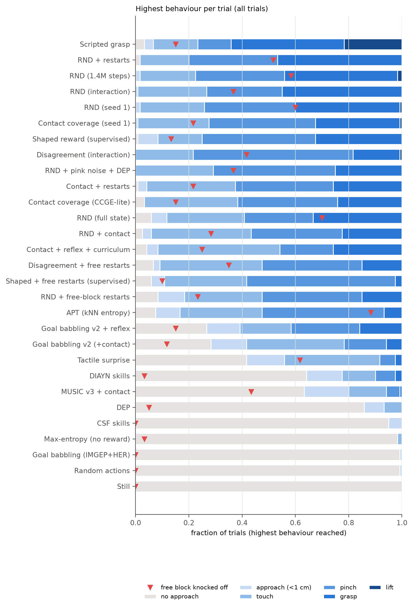

# Reward-free exploration for the monkey arm: overview

Virtual tabletop, 12 November 2026. One laptop, at most 10 CPU cores,
about 8 hours end to end, including the literature review, the
environment, about 25 training runs, evaluation and this report.

## The question

Can a skeletal monkey arm learn to reach, grab and manipulate objects
with **no task reward**? The setup:

- the right arm of the virtual tabletop's monkey model: 7 arm joints and
  16 finger joints, joint position control, MuJoCo contact physics;
- learning from **state**: proprioception, touch and object state; no
  vision;
- driven only by intrinsic objectives from the unsupervised-RL
  literature.

## What was done

1. **Literature review** (Part 1; about 65 papers, including KINESIS and
   its references) on two strands:
   - unsupervised RL: curiosity, state entropy, skill discovery,
     touch-based curiosity;
   - skeletal and musculoskeletal agents: KINESIS, DEP-RL, Lattice,
     synergies, goal babbling, developmental touch.
   
   The main lesson: intrinsic rewards must look at the *interaction*
   with the object, not at the body.
2. **A new play environment** (Part 2):
   - the right arm only (the PPO environment's placement and servos),
     with monkey-scale torque limits;
   - each 3 s trial spawns one block from a procedural library of 10
     shape families (boxes, prisms, cylinders, pyramids, frusta, wedges,
     Platonic solids, bipyramids, random convex hulls, compound L/T/
     cross/step);
   - the block's size (3–7 cm), colour, position and orientation are
     random. It is either **held in space** or **resting free on a pedestal**;
   - observations: 180-D state, including 18 touch patches, a 6×6
     hand-unit × object-face contact map, and the wrench on the object.
3. **Twelve exploration objectives on one SAC learner** (Part 3):
   - knowledge-based: RND (interaction / full state), ensemble
     disagreement, tactile surprise;
   - data-based: APT, contact-coverage counts (CCGE-lite);
   - competence-based: MUSIC, CSF and DIAYN skills;
   - goal-based: modular goal babbling (IMGEP + HER);
   - controls: max-entropy, DEP, random;
   - variants with developmental priors: a fading grasp reflex, a
     static-to-dynamic curriculum, DEP switching and pink noise, and
     Go-Explore-style restarts;
   - references: a **supervised** shaped reward and a scripted IK grasp
     controller.
4. **Evaluation on held-out shapes** (Part 4), with grasp/lift/
   displacement metrics, contact coverage, a behaviour repertoire
   analysis, skill and goal primitives, and **videos**.

## Headline results

<!-- HEADLINES: updated after final evaluations -->
{{generated_headlines}}

## Where to look

| Document | Contents |
|---|---|
| `00_overview.pdf` | this summary |
| `01_literature_review.pdf` | synthesis + per-paper notes (Appendices A, B) |
| `02_environment.pdf` | environment design, shapes, observation, metrics, physics checks |
| `03_methods.pdf` | learner, every objective with its equations, pitfalls, protocol |
| `04_results.pdf` | tables, curves, ethograms, coverage, repertoire, skills, goals |
| `05_appendix.pdf` | every run and its config, the video index |
| `videos/` | held-out behaviour of every policy (mp4), plus showcases |

The code is in `virtual_tabletop/unsupervised_exploration/` (`README.md`).
`PLAN.md` records the plan and every revision made during the day.
