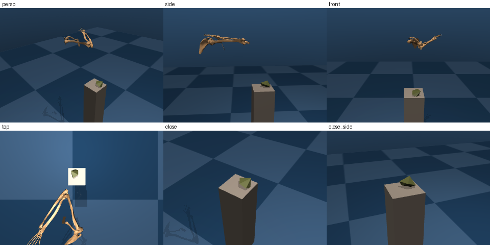
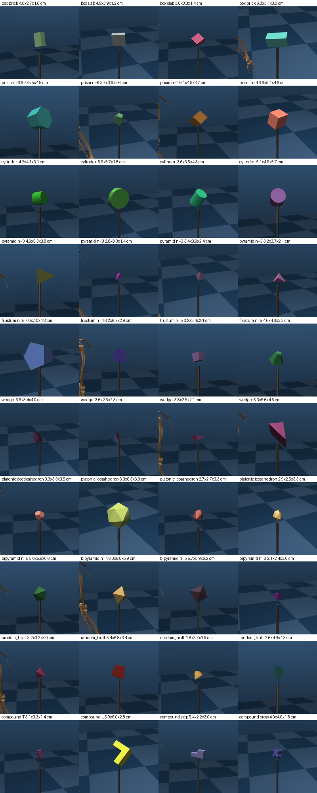
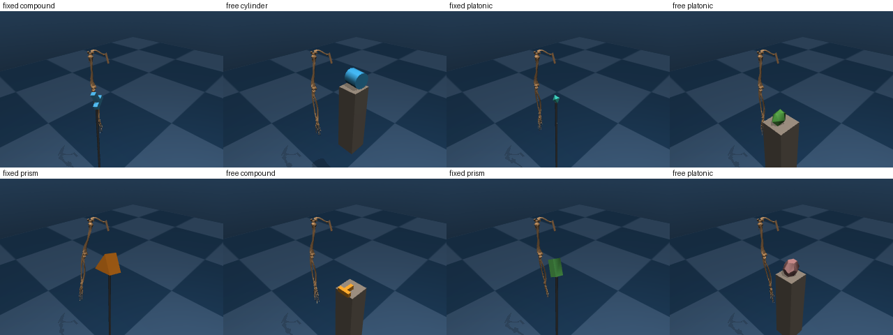
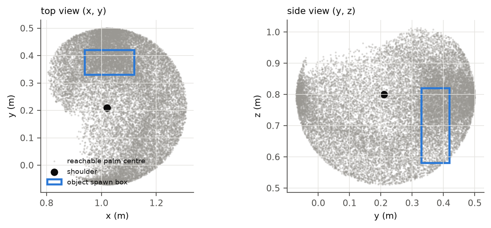

# Part 2: The play environment

This part describes the environment the explorers learn in. The code is
`ue/shapes.py`, `ue/model.py` and `ue/env.py`.

## Requirements

The brief asked for an environment that:

- is like the one used for PPO training on the virtual tabletop, but
  - removes the left arm, and
  - changes the objects;
- puts **one** object in each trial: either a **fixed** object held in
  space, or an **unfixed** object resting on a fixed platform, always
  within reach;
- uses objects that are blocks of widely varied shape (rectangular blocks,
  prisms, polyhedra, and so on), size, colour, position and pose;
- runs trials of a few seconds, then re-spawns the object.

All of these are met, as described below.

## What is kept from the PPO environment

The model is built with the virtual tabletop's own parts
(`virtual_tabletop.assets.parts`):

- the floor, lights and environment;
- the monkey arm from `monkey_arm/right_arm_fingers_v0.xml`, at the RL
  shoulder placement in `config/subject.yaml` (`rl`, shoulder at
  (1.02, 0.21, 0.80) m, facing +y);
- one joint **position servo** per joint ($k_p$ = 50, critically damped),
  with gravity compensation of the 77 g arm, exactly as in
  `rl_actuation`.

As in `PresentationEnv`:

- the arm starts every trial at rest (hanging, fingers straight), plus
  small joint noise (σ = 0.1 rad);
- actions are **delta joint targets**: each action component in [−1, 1]
  moves that joint's servo target by at most 2.5 rad/s × dt, as in the
  PPO runs' `DeltaJointAction`.

All **23 joints** are controlled:

- arm (7): shoulder abduction, flexion and rotation; elbow flexion;
  radial pronation; wrist flexion and abduction;
- fingers (16): thumb (d0 abduction, then d0–d2 flexion) and index,
  middle, ring and pinky (d0–d2 flexion each).

## What changed

- **No left arm.** Only `placements.rl.right` is attached.
- **Objects.** There is one free-jointed `object` body per model. It holds
  a library of 32 procedurally generated shapes. Only the active shape's
  geoms are collidable and visible, and the body's mass and inertia are
  swapped at each trial. The model therefore has a single 6-DoF object
  whatever the library size.
- **Pedestal.** A mocap box (8 × 8 cm top) whose height and position are
  random in each free-object trial.
- **Holding fixed objects.** A weld equality between the world and the
  object is switched on, and a thin rod is drawn under the block.
- **Torque limits per joint group.** The PPO model gives every servo a
  ±5 N·m limit. On a finger joint that allows about 250 N at the
  fingertip, and early tests produced 100–400 N contact forces that
  crushed blocks into the bones and wedged them there. Here the limits
  are:
  - fingers 0.4 N·m;
  - wrist 1.5 N·m;
  - shoulder, elbow and pronation 5 N·m (unchanged).
- **Contact settings for grasping:**
  - elliptic friction cones (impratio 5);
  - friction 1.2 for bones and objects;
  - torsional friction (condim 4) on objects.
- **Collision filtering:**
  - the arm touches the object, the pedestal and itself, but not the
    floor;
  - the object touches the arm, the pedestal and the floor.

  One pitfall cost an early bug. MuJoCo's broad phase filters on the
  per-*body* collision bits, which are compiled from the geoms. Because
  every library geom was compiled as non-colliding, the env also has to
  set the object body's bits at runtime.

## Shapes

`ue/shapes.py` generates convex polyhedra (and unions of boxes) from 10
families. The families are balanced within each library.

| Family | Variants |
|---|---|
| box | cube, slab, bar, brick (random aspect ratios) |
| prism | n-gonal prisms, n ∈ {3, 4, 5, 6, 8}, regular or squashed |
| cylinder | 14-gon prism (a near-cylinder; it rolls when on its side) |
| pyramid | triangular or square base, apex offset |
| frustum | truncated n-gon pyramids, n ∈ {4, 5, 6, 8} |
| wedge | right-triangular prism (ramp) |
| platonic | tetrahedron, octahedron, dodecahedron, icosahedron, stretched along one axis |
| bipyramid | two n-gon pyramids base to base, n ∈ {3, …, 6} |
| random_hull | convex hull of 8–14 random points |
| compound | L, T, cross or step built from 2–3 boxes (non-convex) |

Sizes and masses:

- The largest extent is uniform in 3–7 cm (median 5 cm). This ranges from
  a small cube to a block that fills the hand.
- Density is 500 kg/m³. Masses range from 1 to 83 g (median 12 g).

Shape libraries and seeds:

- Each training env uses its own library seed, so 8 envs see 256 distinct
  shapes.
- **Evaluation uses held-out libraries** (seeds 9000+).
- Colours are drawn from a 10-colour palette with jitter.

## Trials

Each trial lasts **3 s**: 75 control steps at 25 Hz (dt = 0.04 s), with
20 physics substeps of 2 ms. Then a new block spawns and the arm resets
to rest. The block is either:

- **fixed** (probability 0.5 by default; the curricula anneal it): the
  block's bounding-box centre is uniform in the spawn box (x 0.94–1.12,
  y 0.33–0.42, z 0.62–0.82 m), with a uniformly random 3-D orientation;
- **free:** the pedestal top is at a uniform height of 0.58–0.72 m under
  a uniform (x, y) in the same box. The block is dropped from a random
  orientation 2 mm above it and settles for 0.4 s, so it lies on a stable
  face. If it rolls off, the env retries with another orientation.

The spawn box is within reach: 99% of a grid over it lies within 2 cm of a
reachable palm-centre position (`scripts/check_reach.py`, 60k random
postures; worst case 2.7 cm).

## Observation: state only, no vision

The observation is a 180-D float vector. `observation_layout` names its
slices.

| Group | Part | Dim | Content |
|---|---|---|---|
| proprioception | qpos | 23 | joint angles scaled to [−1, 1] by range |
| | qvel | 23 | joint velocities / 10 |
| | target | 23 | current servo targets (efference copy) |
| | palm_pos | 3 | palm centre relative to the shoulder |
| | tips | 15 | 5 fingertips relative to the palm |
| touch | touch | 18 | normal force on the object per patch: palm, 15 finger segments, forearm, upper arm; log(1 + F/0.05 N) |
| | touch_platform | 1 | total arm force on the pedestal |
| | contact_map | 36 | 6 hand units (palm, thumb, index, middle, ring, pinky) × 6 object regions (±x, ±y, ±z faces of its bounding box); tanh(F/0.2 N) |
| | wrench | 6 | net force and torque the hand applies to the object (object frame) |
| | surf_dist | 6 | palm and fingertip distance to the object surface |
| object | obj_rel | 3 | object centre − palm centre |
| | obj_pos | 3 | displacement since spawn |
| | obj_rot | 6 | orientation (two rotation-matrix columns) |
| | obj_drot | 3 | rotation since spawn (rotation vector) |
| | obj_vel | 6 | linear and angular velocity |
| | obj_size | 3 | bounding-box extent |
| | fixed | 1 | 1 if the object is held in space |
| | time | 1 | fraction of the trial elapsed |

Every policy sees the whole vector. That includes the proprioceptive and
tactile inputs for all methods.

The intrinsic rewards read named **feature groups** instead:
- `interaction` (81-D): touch, contact map, wrench, surface distances,
  object-relative position, displacement, rotation since spawn, and
  velocity. It contains no joint angles.
- `skill` (78-D): the same without spawn-dependent offsets.
- `all`: the whole observation. Used by the naive control.

Why `obj_drot` exists: absolute orientation is random at each spawn, so
it identifies the trial. That caused a real confound, described in the
methods.

## Evaluation quantities (never rewards)

The env reports these in `info`. They are used only for evaluation and
are never given to the reward-free learners:

- **touching**: any hand patch presses the object with more than 0.05 N;
- **pinch**: the thumb plus another digit or the palm touch the object;
- **grasp**: two hand units press the object from opposite sides (their
  force-weighted contact normals have a cosine < −0.3);
- **lifted**: a free block is more than 2 cm above its spawn height, off
  the pedestal, and touched by the hand;
- displacement, rotation, minimum hand–surface distance, peak contact
  force, and number of active patches.

## Physics sanity check: the scripted controller

`ue/scripted.py` is a hand-coded reference policy:
1. pre-reach to a forward posture;
2. damped-least-squares IK on the palm grasp point and orientation (palm
   down);
3. descend, close, and lift.

Writing it showed two things:
- From the hanging rest posture, Jacobian IK falls into a local minimum
  that swings the arm backwards. The shoulder needs a pre-reach first.
- The wrist (±30°) and shoulder rotation (±30°) limits make many palm
  orientations unreachable. A palm-down grasp is possible only with the
  fingers pointing forward and medially.

Both are relevant to what the learners discover: the arm's kinematics
make grasping hard. Results for this controller are in Part 4.

## Speed

On one core, the env runs at about 2,500 control steps/s with random
actions, or about 1,300 steps/s with contact queries. In training, the
SAC learner (1 thread) dominates: 150–290 env steps/s per run, depending
on the reward model.
