# Part 4: Results

All numbers are on **held-out shape libraries** (never seen in training).
Each policy gets 120 trials, alternating 60 fixed and 60 free blocks, and
uses its stochastic, exploratory behaviour unless noted otherwise. Unless
stated, runs are 700k env steps (about 9,300 trials, 7.8 h of simulated
play), one seed.

Definitions:
- **touch**: any hand patch > 0.05 N on the block;
- **pinch**: thumb plus another digit or the palm;
- **grasp**: two hand units pushing from opposite sides;
- **lift**: a free block > 2 cm above its spawn height, off the pedestal,
  and in the hand.

Reference points:
- random actions and a still arm never touch the block (0%);
- the hand-coded scripted controller touches 88–98%, grasps 55–73%, and
  lifts 43% of free blocks.

## 1. Main comparison

### Fixed blocks (held in space)

{{generated_table_fixed}}

### Free blocks (on the pedestal)

{{generated_table_free}}

"Displacement, kept on pedestal" is the mean maximum displacement over
the free trials in which the block did not fall. "Knocked off" is the
fraction of free trials in which the block fell off the pedestal.

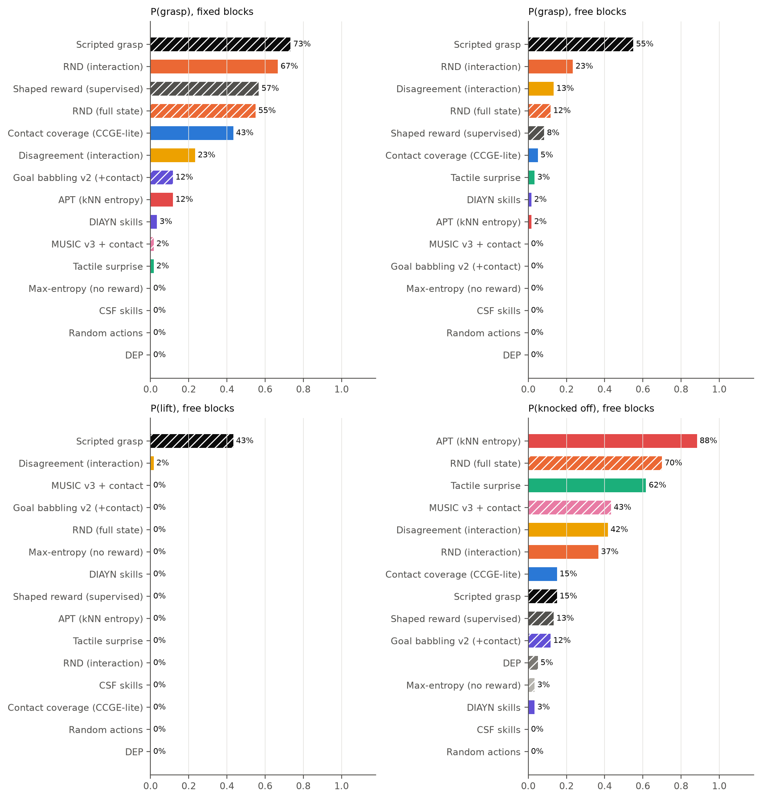

### Behaviour ethograms

Each trial is assigned the highest behaviour it reached. The order is no
approach < approach within 1 cm < touch < pinch < grasp < lift. Red
markers give the fraction of free blocks knocked off.

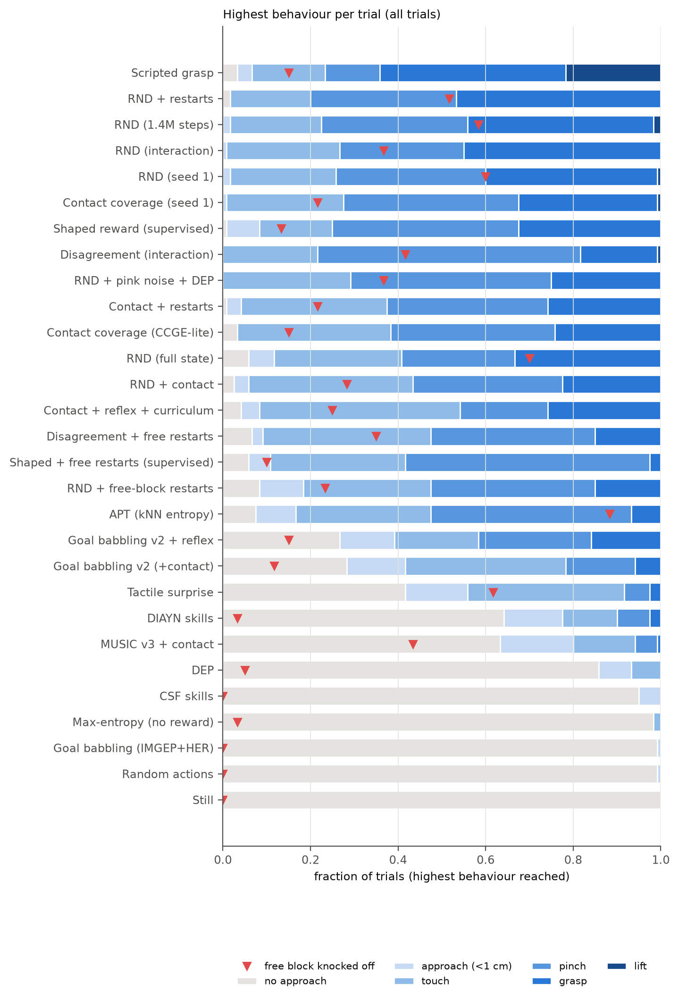

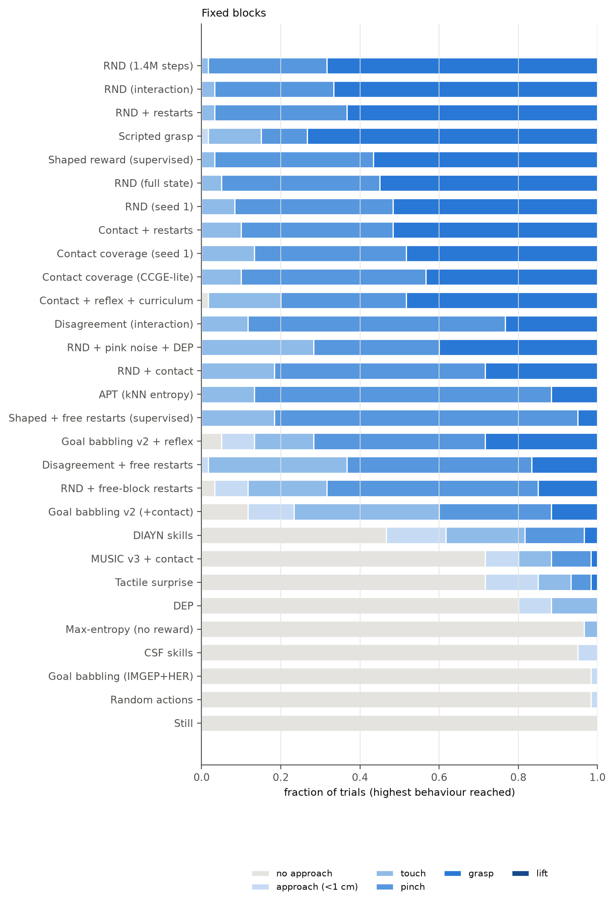

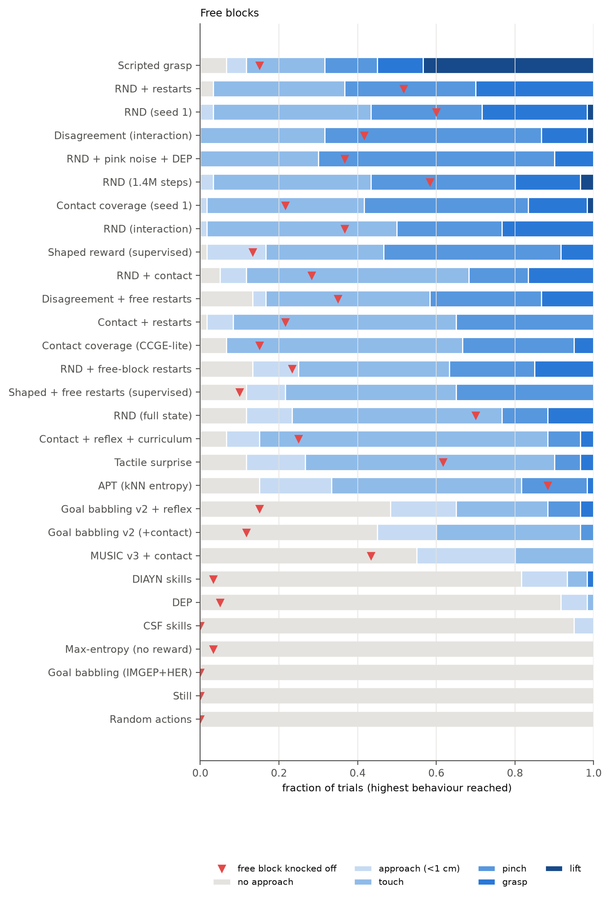

### Coverage

Distinct contact cells: object-state bin × hand unit × object face, out of
36 × 6 × 6 = 1,296. Distinct contact *sets*: which cells are active
together. 2-cm voxels of block displacement, free trials only.

{{generated_table_coverage}}

## 2. Learning curves

These are the training-time trial statistics: the same metrics, measured
on the trials the agent experienced while exploring (training shapes,
including warm-up).

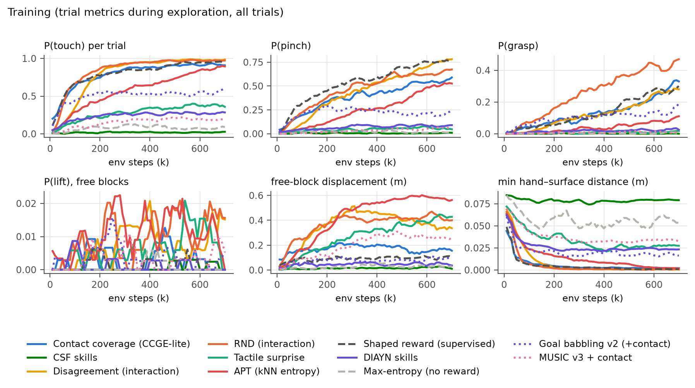

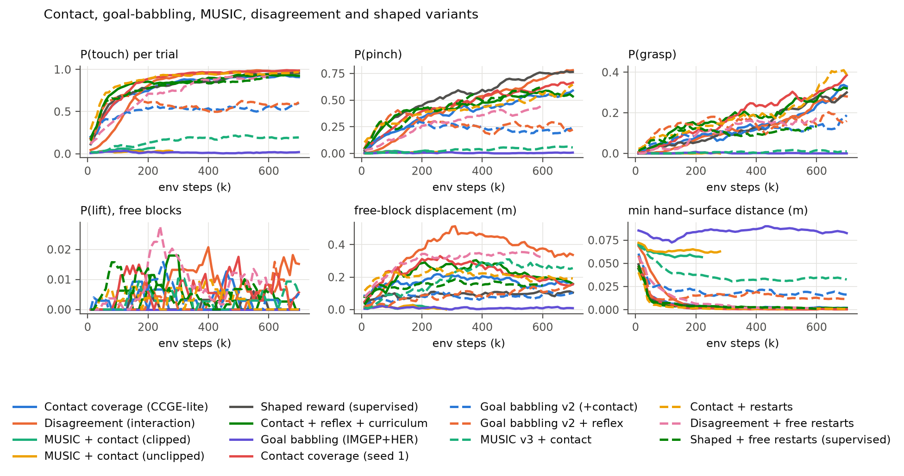

## 3. Findings

<!-- FINDINGS: written after the final evaluations -->
{{generated_findings}}

## 4. Emergent primitives

### Post-hoc behaviour repertoire

Every held-out trial of every method is summarised by a 15-D behaviour
vector:
- contact time, grasp time, lift time;
- number of patches;
- displacement and rotation;
- whether the block was knocked off;
- palm path length and minimum distance;
- the fraction of time each hand unit touches the block.

The trials are pooled and clustered with k-means into 7 clusters. Each
cluster is a post-hoc primitive. The entropy of a method's distribution
over clusters measures how varied its repertoire is.

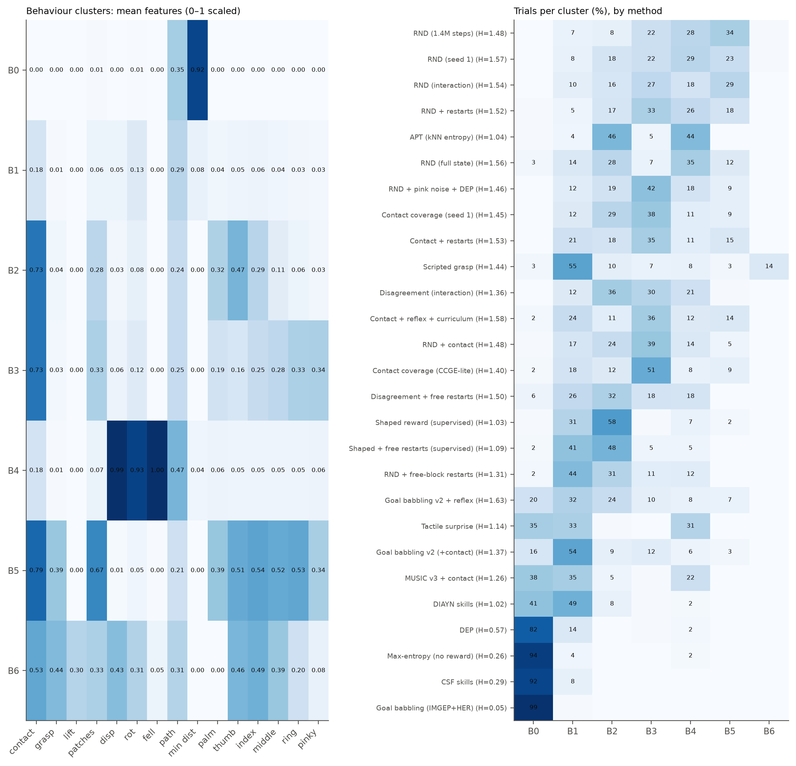

Reading the centroids (left panel), the seven clusters are:

| Cluster | Name | Signature |
|---|---|---|
| B0 | no contact | the hand never reaches the block (min distance ≫ 0) |
| B1 | brief touch | short contact, few patches |
| B2 | radial pinch | thumb + index against the block, sometimes the palm |
| B3 | ulnar-side contact | ring and pinky (and middle) on the block, thumb rarely |
| B4 | knock-off | large displacement and rotation; the free block falls |
| B5 | whole-hand grasp | all five digits and the palm, many patches, opposed contacts |
| B6 | pinch-grasp-and-lift | thumb/index/middle grasp with lifting and carrying |

How the methods use them:
- The **supervised** shaped reward spends 58% of its trials in the radial
  pinch (B2), and most of the rest in brief touches (B1).
- **Contact coverage** favours ulnar-side contact (B3, 51%).
- **RND** spreads its trials over B2–B5, with 18–34% whole-hand grasps
  (B5) across its variants. It has the broadest repertoire among the
  strong explorers.
- **APT** splits between radial pinches and knock-offs.
- Only the **scripted** controller reaches B6 often (14%).
- The weak methods (CSF, max-entropy, DEP, goal babbling v1) sit in B0.

{{generated_table_repertoire}}

### Skills (CSF)

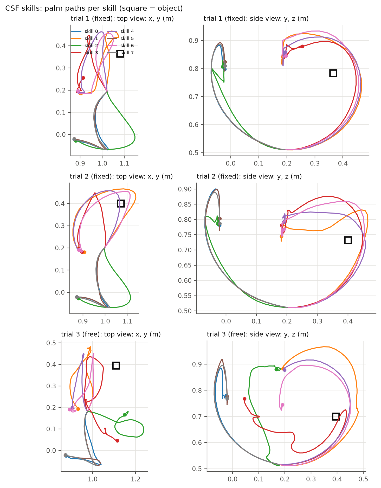

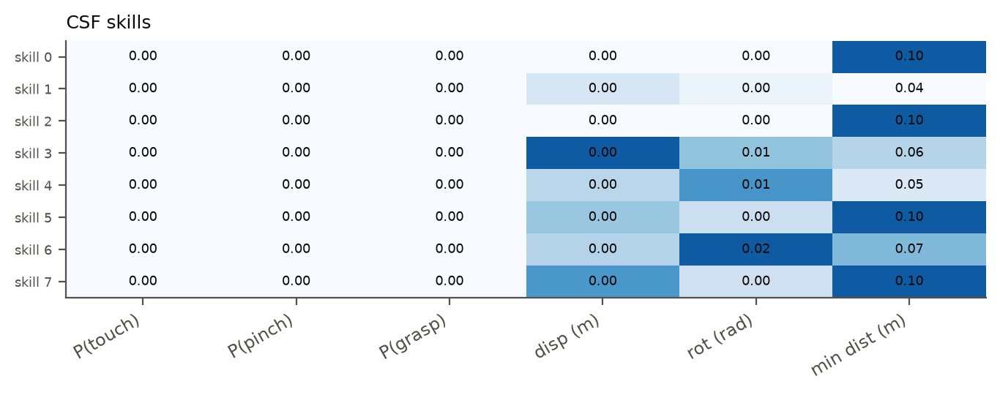

### Skills (DIAYN)

DIAYN's discriminator sees only quantities the agent changes:
- touch, contact map and wrench;
- hand–surface distances;
- displacement, rotation and velocity since spawn.

Unlike CSF's body-centred swings, its 16 skills all approach the block
and end at different places around and above it. The skills are told
apart by where the hand stops relative to the block, which is easy to
discriminate without touching it. So they rarely make contact: 38% of
fixed trials and 7% of free trials touch, with the RND bonus included.
These are object-directed reach primitives, but not manipulation.

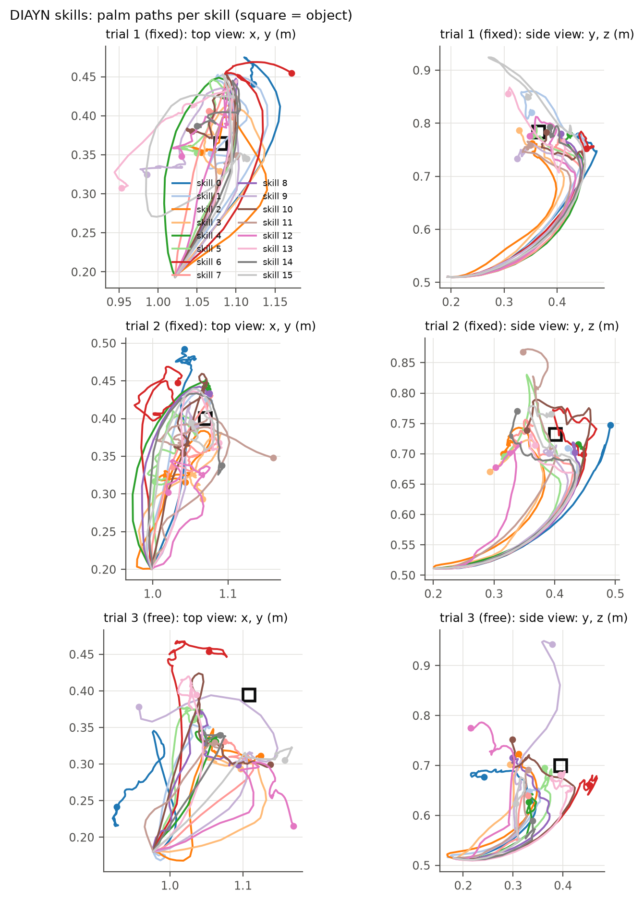

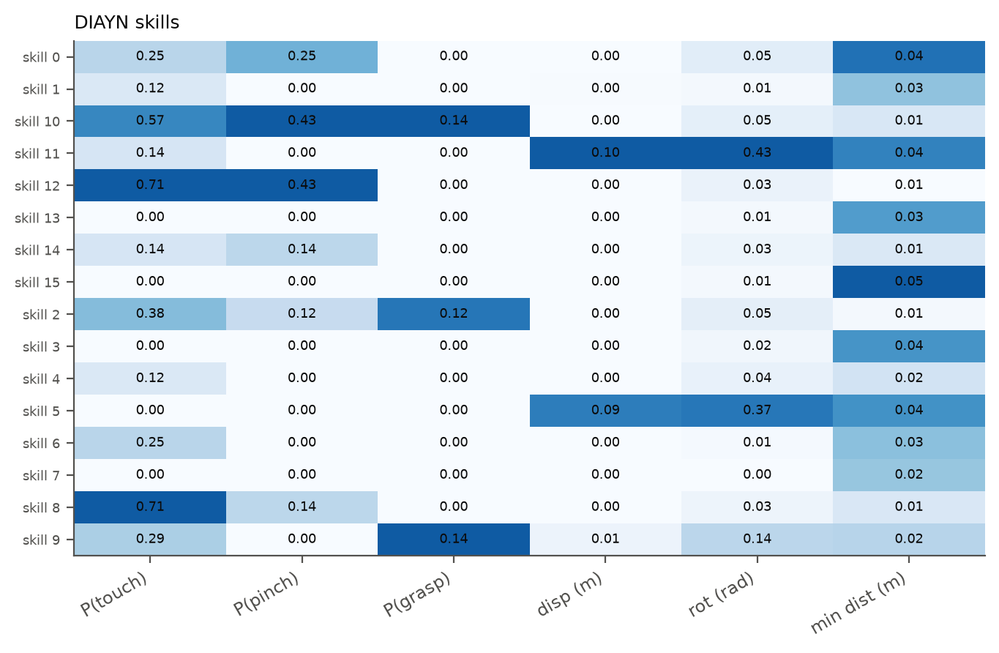

### Goal-conditioned primitives (goal babbling)

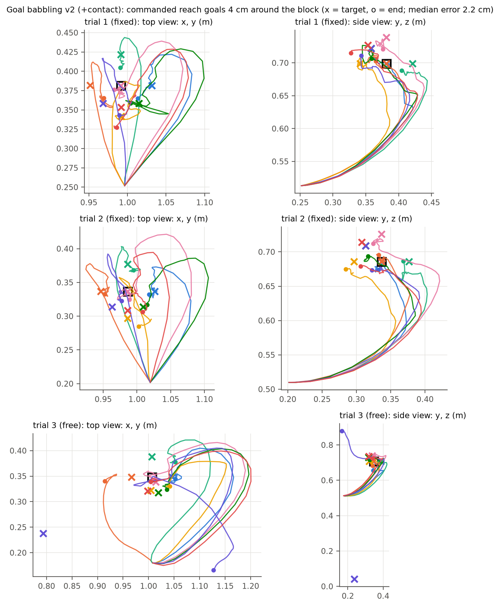

For goal babbling, each evaluation trial gets a self-generated goal in one
module. The table reports success on reaching it at the end of the trial.
"Non-trivial" excludes goals that were already satisfied at the start
(e.g. "don't move the block").

{{generated_table_goals}}

### Finger synergies

Do the explorers develop coordinated finger synergies, as SAR (Berg et
al. 2023) and the KINESIS line of work would suggest? For each policy, the
16 finger joint angles were collected on every step in which the hand
touched the block (40 held-out trials), and analysed with PCA.

{{generated_table_synergies}}

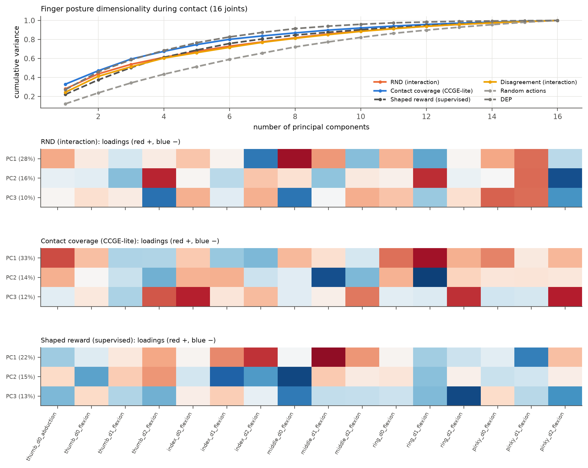

What the PCA shows:
- **The learned policies coordinate their fingers more than random actions do.** PC1 explains 22–33% of the variance, against 12% for
  random actions.
- **They are still far from low-dimensional.** They need 10–11 of 16
  components to explain 90% of the variance.
- **The loadings are not clean anatomical synergies.** There is no
  "close all fingers" component; individual segments load
  idiosyncratically.
- **DEP is as coordinated as any learner** (8 components for 90%),
  without any learning. Its coordination is self-organised, not
  object-directed.

This matches the caution in the KINESIS appendix and in Chiappa et al.
(2024): a few components explain much of the variance, but task-relevant
control stays high-dimensional. A synergy action space built from these
data would need the residual pathway that SAR keeps.

## 5. Stochastic versus deterministic policies

Reward-free objectives keep the policy stochastic, since entropy is part
of SAC's objective. Here is the deterministic (mean-action) version of
each policy on 60 held-out trials:

{{generated_table_det}}

## 6. What the videos show

<!-- QUALITATIVE: written after watching final videos -->
{{generated_qualitative}}
