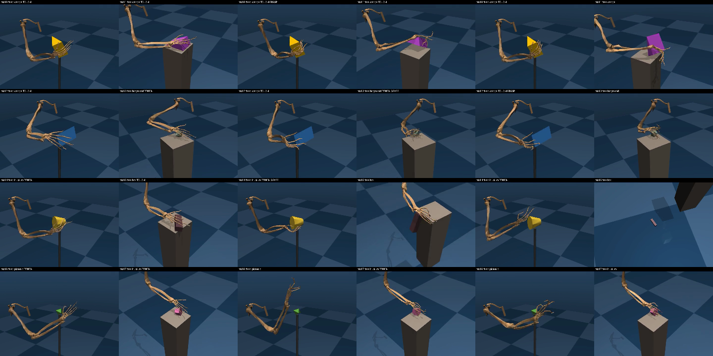
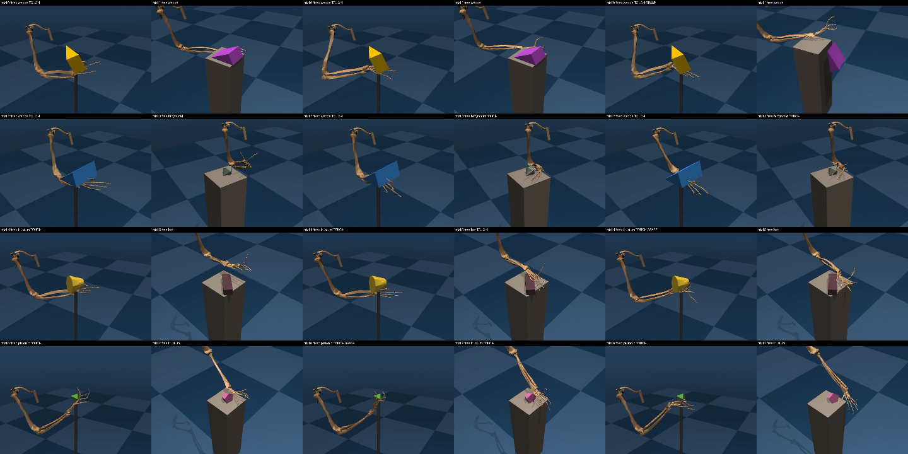
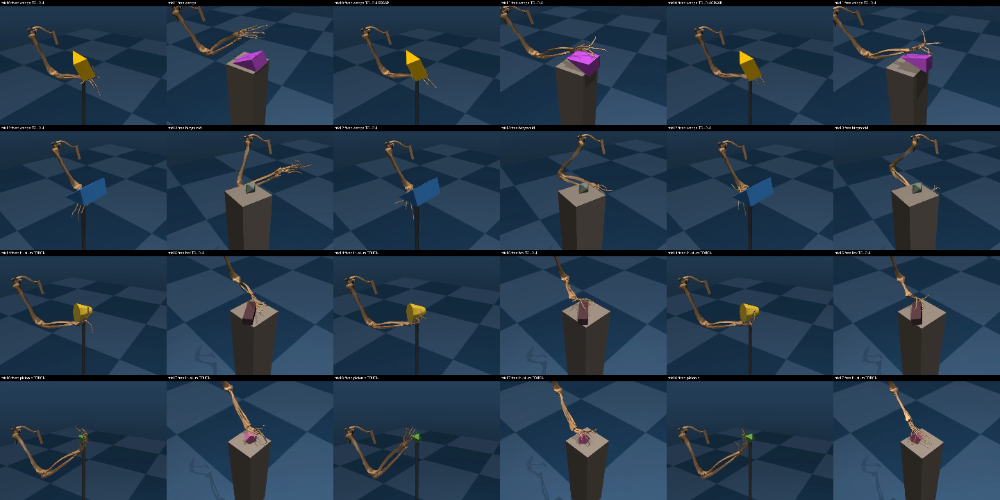

The videos (`report/videos/`; see Part 5) show held-out trials from a
camera that tracks the block. Rows below are 4 trials (fixed and free
alternating); columns are 0.8 s, 1.8 s and 3.0 s.

**Common to all successful explorers.** Every policy that touches the
block first had to discover the same move: lift the hanging arm by
flexing the elbow and shoulder, then bring the hand forward at block
height. The first touch comes 0.6–0.9 s into the trial for fixed blocks
and 0.8–1.4 s for free ones (mean time to touch). It is the first primitive every
method learns (the learning curves show touching rising first), and on
held-out shapes it is executed without hesitation.

**RND (interaction).** The hand arrives with the fingers spread and
curls them around fixed blocks. On free blocks it puts the palm on top
or around the side and keeps working the block: the metrics show large
rotations (1.9 rad on average) and pushes, and in 37% of free trials the
block is pushed off the pedestal.

**Disagreement.** Similar, but in the frames the hand tends to come in
under and around the block. Free blocks are often flipped or pushed off
(42%). It produced the only held-out lifts (2% of free trials), which
were not among the showcased trials.

**Contact coverage.** The gentlest explorer. The hand drapes over the
block with the fingers spread across its faces, and it explores many
finger–face combinations (1,430 contact sets). Free blocks are mostly
nudged and turned rather than knocked off (15%).

**Shaped reward (supervised).** Stereotyped. The hand approaches from the
side with the fingertips first and pinches between thumb and index or
middle finger. The motion is nearly identical across shapes. It looks the
most "purposeful", but it has the narrowest repertoire.

**APT.** Fast, sweeping strikes: the longest palm path of any learner
(0.77 m per trial). They throw free blocks off the pedestal, usually
within the first second (88% of free trials). This maximises the spread of object states at the price of any
sustained contact.

**CSF skills.** Eight large, smooth, repeatable arm swings, such as a
forward loop that passes over the block's position and a swing back and
up behind the body. None of them makes contact. They are clean motor
primitives, but body-centred ones.

**Goal babbling v2.** Goal-directed. Given a reach goal, the hand moves
to a point next to the block and stays near it (the commanded-reach
figure in Section 4). With the reflex prior it grasps fixed blocks more
often (28% vs 12%).

**Scripted controller.** Raises the arm sideways, hovers above the block,
descends, pinches between thumb and fingers, and lifts. The contrast with
the learners shows what is still missing: a top-down approach and a
coordinated thumb–finger closure that holds while the arm moves.

