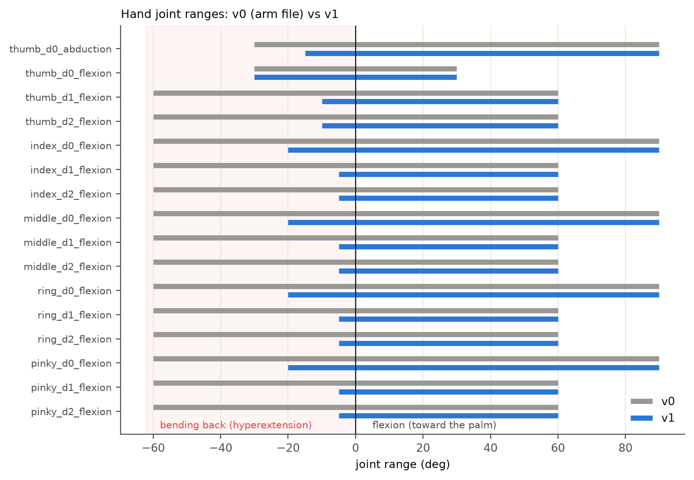
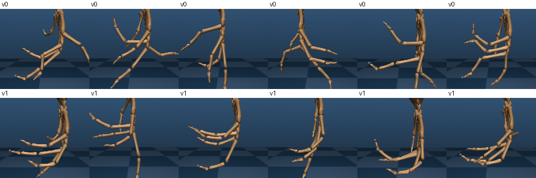
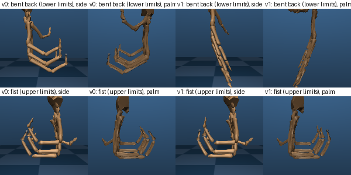
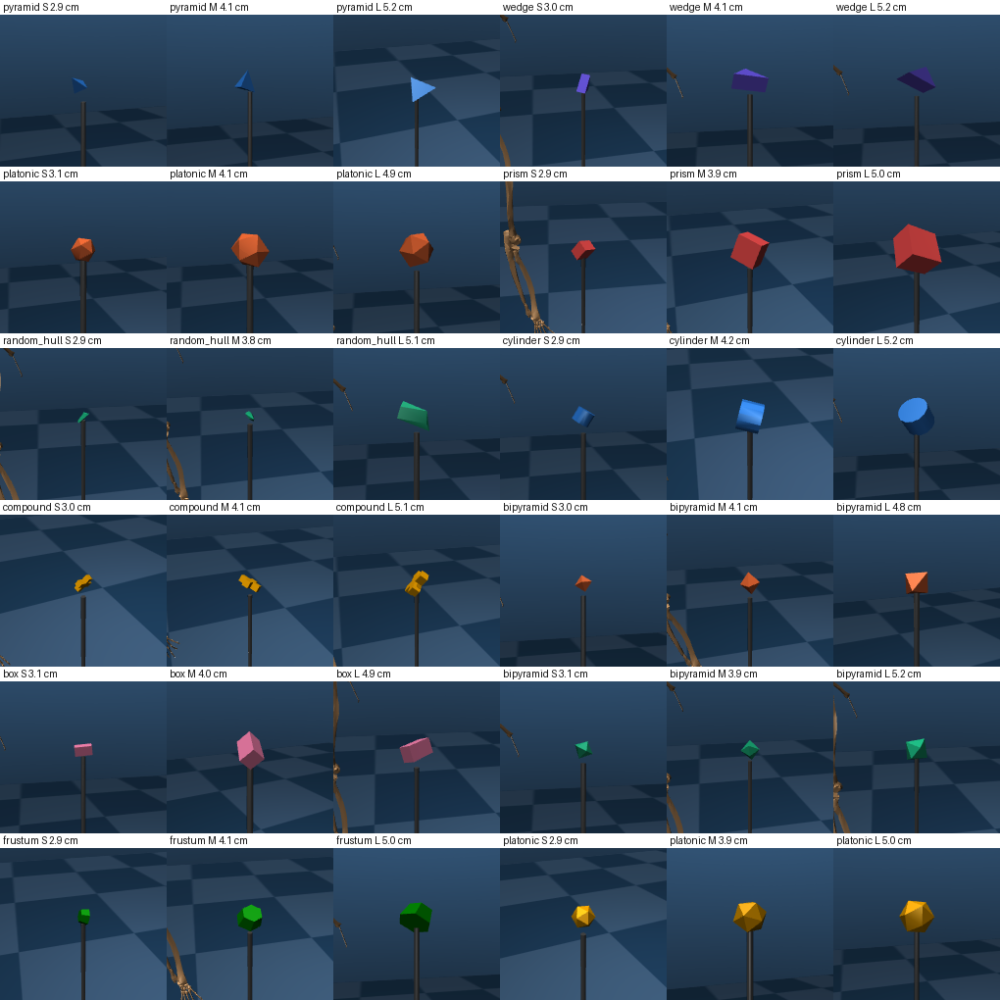
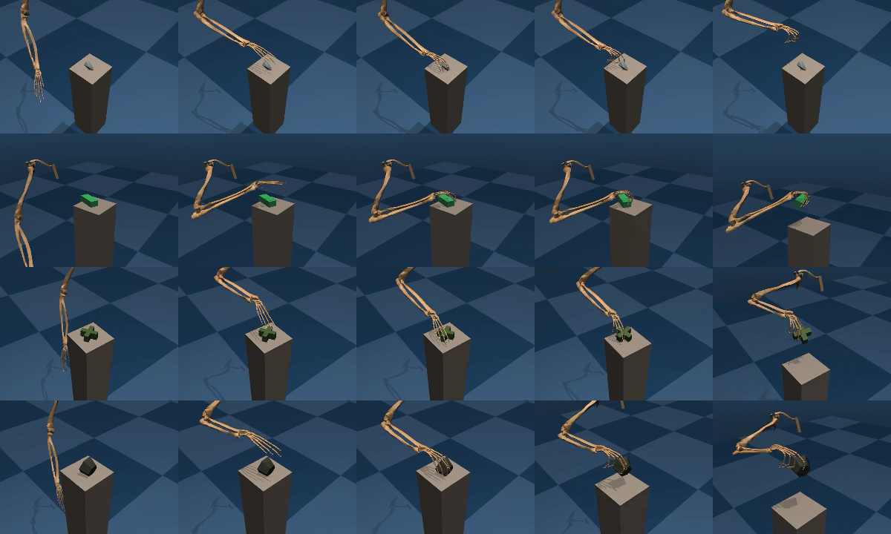

# Part 2: Hand, shapes and the scripted teacher

This part covers what changed in the environment for version 1:
- the hand (natural joint ranges and finger coupling);
- the blocks (smaller, in three sizes);
- the scripted controller that serves as the teacher.

Everything else is as in version 0: trials, observation, physics,
spawning and evaluation (see version_0/report/02_environment.pdf). The
interactive check is the notebook `notebooks/hand_ranges_demo.ipynb`,
with embedded videos of every hand joint, v0 against v1.

## The problem: double-jointed fingers

The arm file (`monkey_arm/right_arm_fingers_v0.xml`) allows every finger
segment to bend **backwards** by up to 60°, and the thumb segments by
30–60°. Nothing in version 0 penalised these postures, so the learned
policies used them.

On held-out trials, version 0's RND held hand joints more than 2° beyond
the natural limits below in **30%** of hand-joint steps. Version 1
policies: 0%, by construction.

The sign convention was measured on the model: positive angles curl a
segment toward the palm. It is the same for all flexion joints, the
thumb included.

## The version 1 hand (`ue/sim/hand.py`)

**Ranges.** Version 1 limits extension only; flexion limits are kept.

| Joint | v0 | v1 |
|---|---|---|
| index–pinky d0 (knuckle, MCP) | −60° … 90° | **−20°** … 90° |
| index–pinky d1 (PIP), d2 (DIP) | −60° … 60° | **−5°** … 60° |
| thumb d1 (MCP), d2 (IP) | −60° … 60° | **−10°** … 60° |
| thumb d0 abduction (CMC) | −30° … 90° | **−15°** … 90° |
| thumb d0 flexion (CMC) | −30° … 30° | −30° … 30° (kept) |

The thumb base keeps its full extension. A first version limited it to
−10°, and the scripted grasp's lift rate fell from 57% to 20%, because
the grasp uses the extended thumb as a post. Extension at the base of the
thumb is a natural movement.

**Coupling.** As with the tendons of real fingers, the DIP (d2) servo
target of each finger follows ⅔ of its PIP (d1) target. The four DIPs
are no longer actions, so there are **19 actions** instead of 23. They
remain physical joints and can give way under contact.

**Scope.** These changes apply only to this project's model, through
`MjSpec` overrides at build time; the compiled ranges are asserted. The
shared arm file and the PPO environment are unchanged.

## Blocks: smaller, in three sizes (`shapes: v1`)

Each library has 12 base shapes from the same 10 families. Each base
shape appears in **three sizes**:
- largest extent of about 3, 4 and 5 cm (±5% jitter);
- masses 1–35 g.

That gives 36 shapes per library. Version 0 drew one size per shape from
3–7 cm, and the largest blocks did not fit the hand: the
thumb-to-fingertip opening is about 4.5 cm.

Training envs and held-out evaluation libraries work as in version 0. The
demonstration libraries (seeds 5000+) are disjoint from both.

## The scripted teacher (`ue/teach/scripted.py`)

The hand-coded controller performs a
**top-down thumb-against-fingers pinch**:
1. It plans each trial on a kinematic copy of the model.
2. It raises the arm sideways, hovers above the block and descends
   vertically.
3. The fingers sweep horizontally toward the extended thumb.
4. It lifts slowly.

Version 1 improved it in several ways:
- **Flat finger sweep.** The fingers pre-curl so their tips start at the
  thumb's height, beyond the block's far face, and close in a straight
  line past the thumb. The old curl dug the fingertips into the pedestal
  on low blocks.
- **Grasp selection.** Candidates are scored by heading (30–190°),
  finger tilt (0–30°) and grip depth (0.8–2 cm). The score combines:
  - whether the block fits the opening;
  - the block's width at the grip;
  - the slope of the gripped faces;
  - the centre-of-mass offset;
  - a reachability check (one IK solve per candidate).
- **Straight vertical approach and lift**, so the thumb no longer swings
  onto the block's top.
- **Coupling-aware finger tables:** DIP = ⅔ PIP, and no posture outside
  the v1 ranges.

The version 0 controller is frozen as `ue/teach/scripted_v0.py` and
still reproduces the version 0 baselines.

| Setting (free blocks) | Lift | Held at end | Grasp | Fell |
|---|---|---|---|---|
| v0 controller, v0 hand, v0 shapes (40 trials) | 57% | – | 62% | – |
| v0 controller, v1 hand, v1 shapes (90 trials) | 68–70% | 56% | 79% | 6–7% |
| **v1 controller, v1 hand, v1 shapes** (90 trials) | **81%** | **74%** | 88% | 1% |
| v1 controller, demonstration libraries (750 free trials) | 74% | – | – | – |

Fixed blocks: an opposed grasp in 85% of trials (60 trials), and 77% on
the 750 fixed demonstration trials.

Held-out baseline evaluation, on the same protocol as the learners
(120 trials):

{{generated_table_scripted}}

Remaining failure modes:
- steep pointed blocks (pyramids, irregular hulls), which are squeezed
  out downward during the lift;
- 5 cm flat prisms, wider than the opening along every heading the arm
  can reach;
- grasps lost mid-lift. There is no time to retry, because the lift
  starts at about step 53 of 75.

