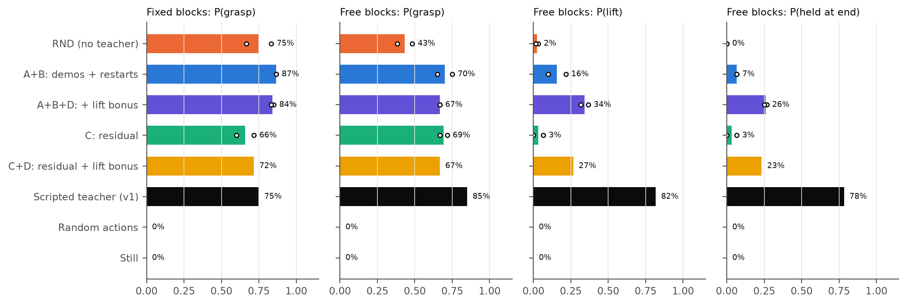
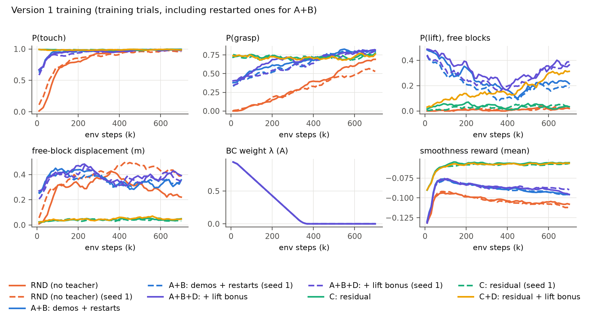

# Part 4: Results

All numbers are on **held-out shape libraries** (v1 shapes, never seen
in training). Each policy gets 120 trials, alternating fixed and free
blocks, and acts stochastically, as it does during exploration. For
setups with two seeds, the tables give the mean, with each seed in
brackets. C+D (`res_lift`) has one seed, by choice, to finish earlier.

## 1. Can they grasp and lift?

{{generated_v1_main}}

## 2. Manipulation while lifted (free blocks)

{{generated_v1_manip}}

- **Lifted time:** mean seconds per trial with the block lifted (out of
  3 s).
- **Carry:** distance the block travels while lifted.
- **Turn:** rotation of the block while lifted (in-hand reorientation).
- **Lift events:** separate lifts per trial; more than 1 means regrasps.

## 3. Naturalness and exploration

{{generated_v1_natural}}

- **Hand joints past natural limits:** the fraction of hand-joint steps
  more than 2° beyond the v1 ranges. It is 0 for v1 by construction; the
  version 0 row is the "before".
- **Jerk** and **effort:** mean squared change and size of the executed
  action.
- **Residual ratio** (C only): mean |0.5·a_π| / mean |a_script|, i.e. how
  far the policy departs from the script.
- **Contact sets and cells:** the version 0 coverage measures. Does
  teaching collapse exploration onto the scripted pinch?

## 4. Learning curves

## 5. Findings

{{generated_v1_findings}}

## 6. Behaviour

{{generated_v1_qualitative}}
